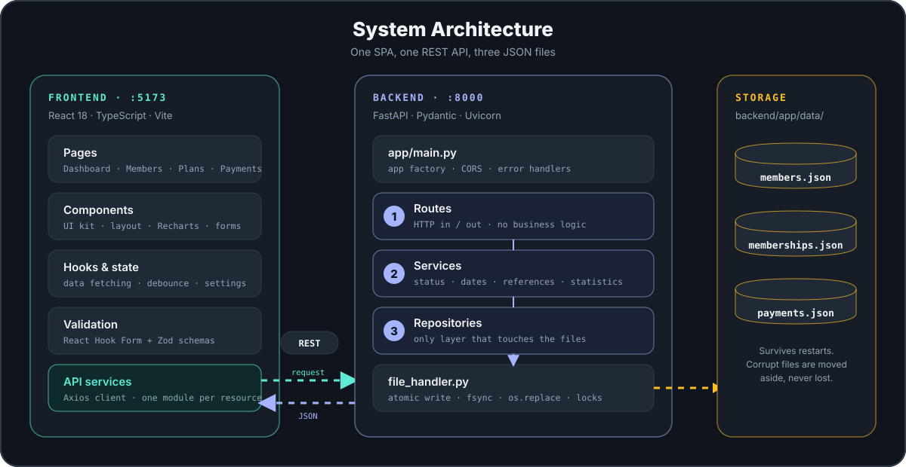
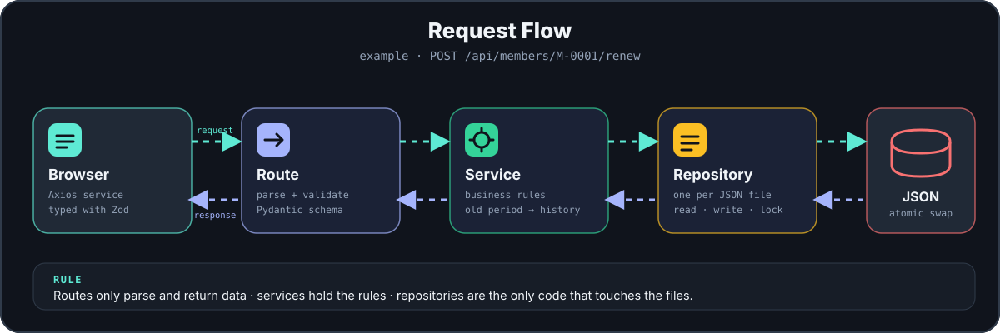
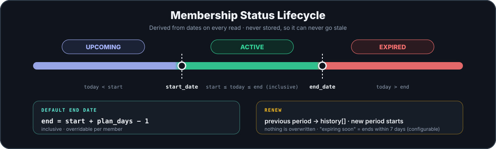
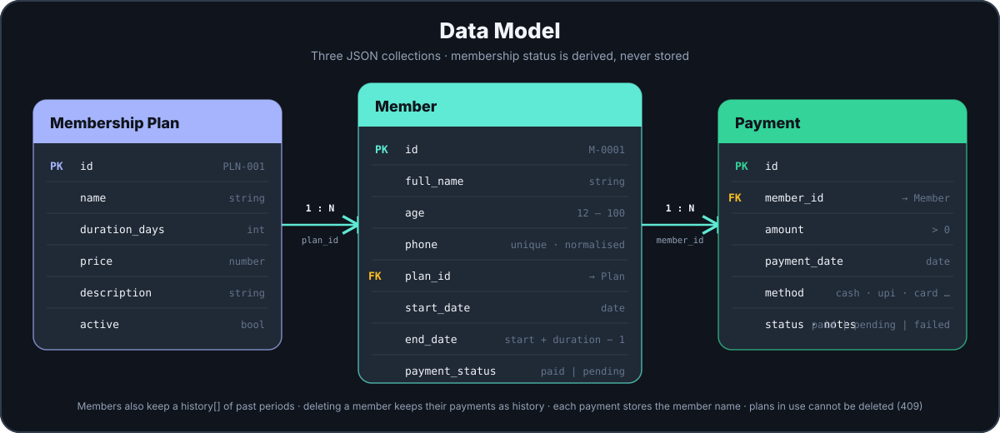

<div align="center">



<br/>

**A full-stack gym management app for members, membership plans and payment records.**
<br/>
React + TypeScript on the front, a modular FastAPI service on the back, and JSON files that survive every restart.

<br/>


<br/><br/>

[✨ Features](#-features) · [🏗️ Architecture](#%EF%B8%8F-architecture) · [🚀 Quick start](#-quick-start) · [📡 API](#-api-documentation) · [🧠 Business rules](#-business-rules) · [🧪 Testing](#-testing)

<br/>

> [!NOTE]
> Payments are **record keeping only**. Forma never processes real transactions.


</div>

## 🧭 At a glance

<div align="center">

</div>

| | |
| :-- | :-- |
| 🎯 **Purpose** | Run a gym's day-to-day: who is a member, which plan, who has paid, who is about to expire |
| 🧱 **Frontend** | React 18 · TypeScript · Vite · Tailwind · Framer Motion · Recharts |
| ⚙️ **Backend** | FastAPI · Pydantic · Uvicorn, layered as route → service → repository |
| 💾 **Storage** | Three JSON files with atomic writes, no database to install |
| 🎨 **Design** | Cold-toned dark system with a teal accent, plus light and system themes |
| 🧪 **Tests** | pytest for the API, Vitest + Testing Library for the UI |


## ✨ Features

<table>
<tr>
<td width="50%" valign="top">

### 📊 Dashboard
- KPI cards: total, active and expired members, pending payments
- Membership **distribution** and **growth** charts (Recharts)
- Recent registrations, recent payments, upcoming expirations, quick actions
- Every figure is calculated by the backend

</td>
<td width="50%" valign="top">

### 👥 Members
- Create, view, edit, delete and **renew**; detail drawer with membership history
- Debounced search by member ID, name or phone
- Filters: status (active / expired / upcoming), expiring soon, payment status, plan
- Sorting and pagination; table on desktop, cards on small screens

</td>
</tr>
<tr>
<td width="50%" valign="top">

### 🏷️ Membership plans
- Create, view, edit, delete and search plans: name, duration in days, price, description, active flag
- A plan that members still use **cannot be deleted** (HTTP 409). Mark it inactive instead

</td>
<td width="50%" valign="top">

### 💳 Payments
- Record, view, edit, delete and search; filter by status and method
- Per-member payment history, totals and recent transactions
- Methods: `cash` `upi` `card` `bank_transfer` `other`
- Statuses: `paid` `pending` `failed`

</td>
</tr>
<tr>
<td width="50%" valign="top">

### ⚙️ Settings
- Gym details, theme (dark / light / system), page size and sidebar preference, saved in the browser
- Backend info (version, data folder, record counts) and a full **JSON data export**

</td>
<td width="50%" valign="top">

### 🎛️ Interface
- Semantic colour tokens, collapsible sidebar, global search, mobile navigation
- Framer Motion transitions on transform and opacity, `prefers-reduced-motion` respected
- Loading skeletons, error states with retry, toasts, inline validation (React Hook Form + Zod)

</td>
</tr>
</table>


## 🏗️ Architecture

<div align="center">

</div>

### 🔁 Request flow

<div align="center">

</div>

Routes only parse and return data, services hold the business rules, and repositories are the only code that touches the files.

### 🗂️ Project structure

<details>
<summary><b>Open the folder tree</b></summary>

```text
gym-management-system/
├── backend/                 FastAPI application
│   ├── app/
│   │   ├── main.py          app factory, CORS, error handlers
│   │   ├── config.py        environment-driven settings
│   │   ├── container.py     wires repositories and services
│   │   ├── errors.py        domain errors mapped to HTTP codes
│   │   ├── seed.py          demo data generator
│   │   ├── routes/          HTTP layer (members, memberships, payments, dashboard, system)
│   │   ├── schemas/         Pydantic request and response models
│   │   ├── services/        business rules (status, dates, references, statistics)
│   │   ├── repositories/    one repository per JSON file
│   │   ├── utils/           file_handler.py (atomic JSON storage), validators.py
│   │   └── data/            members.json, memberships.json, payments.json
│   └── tests/               pytest suite
├── frontend/                React + TypeScript + Vite
│   └── src/
│       ├── components/      ui kit, layout, charts, feature components
│       ├── pages/           Dashboard, Members, Plans, Payments, Settings
│       ├── layouts/         app shell
│       ├── services/        Axios client and one API module per resource
│       ├── hooks/           data fetching, debounce, settings, media queries
│       ├── types/           TypeScript types mirroring the API
│       ├── utils/           formatting, motion presets, Zod schemas
│       ├── styles/          Tailwind layers and design tokens
│       └── test/            Vitest suites and an in-memory fake API
├── docs/assets/             README banner and SVG diagrams
├── run.bat                  one-click launcher (Windows)
├── README.md
├── .env.example
└── .gitignore
```

</details>


## 🚀 Quick start

### ⚡ One click (Windows)

Double-click **`run.bat`** in the project root, or run it from a terminal.

On first run it creates the backend virtual environment, installs backend and frontend dependencies, starts both servers in two windows and opens **http://localhost:5173**. Close the two windows to stop them.

| Service | URL |
| :-- | :-- |
| 🖥️ Frontend | http://localhost:5173 |
| ⚙️ Backend API | http://localhost:8000 |
| 📘 Swagger UI | http://localhost:8000/docs |

### 📋 Requirements

- Python **3.11+** (developed with 3.14)
- Node.js **18+** (developed with 25) and npm

### 📦 Installation

<details open>
<summary><b>🪟 Windows (PowerShell)</b></summary>

```powershell
# Backend
cd backend
python -m venv .venv
.\.venv\Scripts\python.exe -m pip install -r requirements.txt

# Frontend
cd ..\frontend
npm install
```

</details>

<details>
<summary><b>🍎 macOS / 🐧 Linux</b></summary>

```bash
cd backend && python3 -m venv .venv && .venv/bin/pip install -r requirements.txt
cd ../frontend && npm install
```

</details>

### ▶️ Running manually

Use two terminals.

**Terminal 1 · backend** (http://localhost:8000)

```powershell
cd backend
.\.venv\Scripts\python.exe -m uvicorn app.main:app --reload --port 8000
```

**Terminal 2 · frontend** (http://localhost:5173)

```powershell
cd frontend
npm run dev
```

On first start the backend creates demo plans, members and payments if all three data files are empty. Set `GYM_SEED_DEMO_DATA=false` to disable that.

<details>
<summary><b>🌱 Regenerate demo data</b> (overwrites existing records)</summary>

```powershell
cd backend
.\.venv\Scripts\python.exe -m app.seed --reset
```

</details>

**Production build:** `npm run build` (output in `frontend/dist`), preview with `npm run preview`.


## 🔧 Configuration

Both parts run with defaults and no configuration. To change a setting, copy `.env.example` to `backend/.env` and `frontend/.env`, or use the per-folder example files.

| Variable | Used by | Default | Meaning |
| :-- | :-: | :-- | :-- |
| `GYM_DATA_DIR` | ⚙️ backend | `backend/app/data` | Folder holding the three JSON files |
| `GYM_CORS_ORIGINS` | ⚙️ backend | `http://localhost:5173,http://127.0.0.1:5173` | Comma-separated browser origins allowed to call the API |
| `GYM_EXPIRY_WARNING_DAYS` | ⚙️ backend | `7` | A membership is "expiring soon" when it ends within this many days |
| `GYM_SEED_DEMO_DATA` | ⚙️ backend | `true` | Create demo data on first start when every data file is empty |
| `VITE_API_BASE_URL` | 🖥️ frontend | `http://localhost:8000` | Backend base URL, without a trailing slash or `/api` |


## 📡 API documentation

Interactive Swagger UI is served at **http://localhost:8000/docs** (ReDoc at `/redoc`, OpenAPI JSON at `/openapi.json`).

| Area | Endpoints |
| :-- | :-- |
| 👥 **Members** | `GET /api/members` (search, filters, sorting, pagination) · `GET /api/members/search` · `GET` `PUT` `DELETE /api/members/{id}` · `POST /api/members` · `POST /api/members/{id}/renew` |
| 🏷️ **Plans** | `GET` `POST /api/memberships` · `GET` `PUT` `DELETE /api/memberships/{id}` |
| 💳 **Payments** | `GET` `POST /api/payments` · `GET /api/payments/summary` · `GET /api/payments/member/{member_id}` · `GET` `PUT` `DELETE /api/payments/{id}` |
| 📊 **Dashboard** | `GET /api/dashboard/stats` · `recent-members` · `recent-payments` · `membership-distribution` · `membership-growth` · `expiring-memberships` |
| 🖥️ **System** | `GET /api/health` · `GET /api/system/info` · `GET /api/system/export` |

<details>
<summary><b>🚦 Error format and status codes</b></summary>

<br/>

Errors use a consistent body: `{"detail": "message"}`. Validation errors (422) also include `"errors": [{"field", "message"}]`.

| Code | Meaning |
| :-: | :-- |
| `201` | Created |
| `204` | Deleted |
| `404` | Unknown record |
| `409` | Conflict: duplicate phone number, or plan still in use |
| `422` | Invalid input |
| `503` | Storage unavailable |

</details>


## 🧠 Business rules

<div align="center">

</div>

- 🗓️ **Membership status is derived from dates, never stored.** *Upcoming* starts in the future, *active* means today is between start and end inclusive, *expired* means the end date has passed.
- 🧮 **End date** defaults to `start_date + plan duration − 1 day` (inclusive) unless one is supplied.
- 💳 **Payment status is separate from membership status.** A member can be active with a pending payment.
- ♻️ **Renewing** moves the previous period into the member's history instead of overwriting it.
- 📞 Phone numbers are normalised and must be unique per member. Payments must reference an existing member.
- 🔒 Plans in use cannot be deleted. Payment statuses are set by staff and never changed automatically; recording a payment does not alter a member's own payment status.
- 🧾 Deleting a member keeps their payment records as history (each record stores the member name).


## 💾 Data storage

<div align="center">

</div>

<br/>

Data lives in three JSON files (by default in `backend/app/data/`): `members.json`, `memberships.json` and `payments.json`. Each is a list of records.

- 📄 Missing files are created automatically; empty files are treated as empty lists.
- ⚛️ Writes go to a temporary file in the same folder, are flushed and fsynced, then swapped in with `os.replace`, so a crash mid-write cannot leave a half-written file.
- 🩹 A corrupted file is moved aside as `<name>.corrupt-<timestamp>` and replaced by an empty list.
- 🔐 Access is serialised with per-file locks.
- 📁 Use `GYM_DATA_DIR` to keep the data outside the repository. The tests always use temporary folders.


## 🧪 Testing

```powershell
# Backend (pytest, isolated temporary storage)
cd backend
.\.venv\Scripts\python.exe -m pytest

# Frontend (Vitest + Testing Library, with an in-memory fake API)
cd frontend
npm test
npm run typecheck
```

| Suite | What it covers |
| :-- | :-- |
| ⚙️ **Backend** | Members, plans, payments, status calculation, dashboard figures, invalid requests, missing references, file storage |
| 🖥️ **Frontend** | Real pages, hooks and services against a fake network layer: adding, editing, deleting and searching members, creating plans, recording payments, the dashboard and API error states |


## 🧰 Tech stack

<div align="center">

| Layer | Tools |
| :-- | :-- |
| 🖥️ **Frontend** | React 18 · TypeScript · Vite · Tailwind CSS · Framer Motion · Recharts · Lucide React · React Router · Axios · React Hook Form · Zod |
| ⚙️ **Backend** | FastAPI · Pydantic · Uvicorn |
| 🧪 **Testing** | pytest · Vitest · Testing Library |
| 🔤 **Fonts** | Manrope (display) · Inter (UI) · JetBrains Mono (numbers) |

</div>

### 🎨 Design tokens

<div align="center">

| Token | Hex | Used for |
| :-- | :-: | :-- |
|  `canvas` | `#10141C` | Page background |
|  `surface` | `#202936` | Cards |
|  `accent` | `#5EEAD4` | Primary accent, used sparingly |
|  `accent2` | `#A5B4FC` | Secondary accent |
|  `ok` | `#34D399` | Success, active |
|  `warn` | `#FBBF24` | Warnings, expiring soon |
|  `err` | `#F87171` | Errors, expired, failed |

</div>

<br/>

<div align="center">


**Forma** · built with React, FastAPI and a lot of reps 🏋️

</div>
